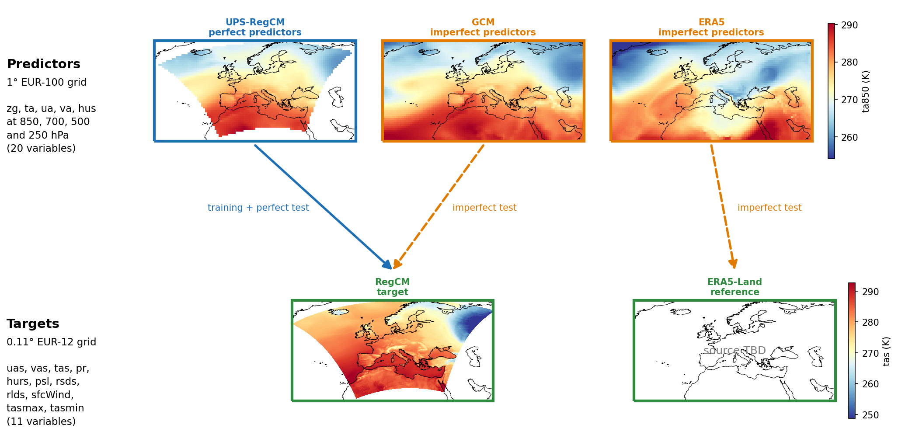

# Data

The benchmark combines five datasets: two sources of **targets** on the 0.11° EUR-12 grid and three sources of **predictors** on
a common 1° grid. The figure shows one day of each and the role it plays.



*Top: predictor `ta850` from RegCM5-0 upscaled to 1° (perfect), from the driving GCM and from ERA5 (imperfect). Bottom: target
`tas` from RegCM5-0, and ERA5-Land. Blue: data used for training and for the perfect test; orange: imperfect test; green: ground
truth. For illustration, the GCM-driven panels show the EC-Earth3-Veg simulation on 15 January 2050 and the ERA5 panel shows
15 January 1995.*

## Targets

All targets are daily fields of `uas`, `vas`, `tas`, `pr`, `hurs`, `psl`, `rsds`, `rlds`, `sfcWind`, `tasmax` and `tasmin` on the
**EUR-12** grid (rotated pole, 0.11°, 412 × 424 grid points).

### RegCM5-0

The **ICTP RegCM5-0** simulations of CORDEX-CORE-CMIP6 over EUR-12. They are the ground truth for training and for every test
with perfect predictors.

| Driver | Scenarios | Variant | Calendar |
|---|---|---|---|
| EC-Earth3-Veg | historical, ssp370 | r1i1p1f1 | proleptic Gregorian (ssp370 ends 2099-11-30) |
| MPI-ESM1-2-HR | historical, ssp370 | r1i1p1f1 | proleptic Gregorian |
| NorESM2-MM | historical, ssp370 | r1i1p1f1 | 365-day (no leap years) |
| ERA5 | evaluation | r1i1p1f1 | proleptic Gregorian |

### ERA5-Land

The reference of the ERA5-imperfect test, against which the emulators driven by ERA5 are compared. *Source pending.*

## Predictors

All predictors are daily fields of geopotential height `zg`, air temperature `ta`, eastward and northward wind `ua`, `va`, and
specific humidity `hus`, each at 850, 700, 500 and 250 hPa (20 variables, e.g. `ta850`). They share a regular 1° grid (`EUR-100`),
104 × 52 cells with cell centres from 42.5°W to 60.5°E and from 19.5°N to 70.5°N.

### UPS-RegCM (perfect)

The RegCM5-0 simulations, interpolated from the 0.11° EUR-12 grid to the 1° grid by bilinear interpolation. Models are trained on these predictors, and they are also used for the perfect test.

The 1° box is larger than the rotated EUR-12 domain: the cells outside the RegCM5-0 domain are NaN (43 % of the box), and the file
`mask_EUR-100_ICTP_RegCM5-0_fx.nc` marks the valid cells.

### GCMs (imperfect)

The CMIP6 models that drive RegCM5-0, interpolated from their native grid to the 1° grid by inverse-distance weighting, with
missing values below the ground filled by the nearest valid neighbour. They are full fields over the whole box; apply the mask
at inference if your model needs it.

| GCM | Scenarios | Variant | Calendar |
|---|---|---|---|
| EC-Earth3-Veg | ssp370 (historical pending) | r1i1p1f1 | proleptic Gregorian |
| MPI-ESM1-2-HR | historical, ssp370 | r1i1p1f1 | proleptic Gregorian |
| NorESM2-MM | historical, ssp370 | r1i1p1f1 | 365-day (no leap years) |

### ERA5 (imperfect)

The ERA5 reanalysis, interpolated from 0.25° to the 1° grid by bilinear interpolation. It drives the RegCM5-0 evaluation run, and is used as imperfect predictor for the 1981-2000 evaluation period.

## Data blocks

The data are organised in **blocks**, one per driver and period, with the predictors and the targets of that period. The
training blocks are grouped by experiment and the test blocks, common to all experiments, are kept apart. A block never mixes
historical and scenario years (the split is at 2014/2015).

```
SOURCE_FILES/
├── mask_EUR-100_ICTP_RegCM5-0_fx.nc
├── train/
│   ├── Experiment_A/
│   │   └── EC-Earth3-Veg/
│   │       ├── 1961-1980/
│   │       │   ├── predictors/
│   │       │   │   └── predictors_EUR-100_EC-Earth3-Veg_historical_r1i1p1f1_ICTP_RegCM5-0_v1-r1_day_19610101-19801231.nc  # perfect
│   │       │   └── target/
│   │       │       ├── hurs_EUR-12_EC-Earth3-Veg_historical_r1i1p1f1_ICTP_RegCM5-0_v1-r1_day_19610101-19801231.nc
│   │       │       ├── pr_EUR-12_EC-Earth3-Veg_historical_r1i1p1f1_ICTP_RegCM5-0_v1-r1_day_19610101-19801231.nc
│   │       │       └── ...                                                                                         # 11 variables
│   │       └── 2080-2099/                                                                                          # same layout
│   ├── Experiment_B/
│   │   └── EC-Earth3-Veg/    1961-1980, 2001-2014, 2015-2040, 2061-2079, 2080-2099
│   └── Experiment_C/
│       ├── EC-Earth3-Veg/    1961-1980, 2080-2099
│       ├── MPI-ESM1-2-HR/    1961-1980, 2080-2099
│       └── NorESM2-MM/       1961-1980, 2080-2099
└── test/
    ├── EC-Earth3-Veg/        1981-2000, 2041-2060
    ├── MPI-ESM1-2-HR/
    │   ├── 1981-2000/
    │   │   ├── predictors/
    │   │   │   ├── predictors_EUR-100_MPI-ESM1-2-HR_historical_r1i1p1f1_ICTP_RegCM5-0_v1-r1_day_19810101-20001231.nc  # perfect
    │   │   │   └── predictors_EUR-100_MPI-ESM1-2-HR_historical_r1i1p1f1_day_19810101-20001231.nc                      # imperfect
    │   │   └── target/                                                                                             # 11 variables
    │   └── 2041-2060/                                                                                              # same layout
    ├── NorESM2-MM/           1981-2000, 2041-2060
    └── ERA5/                 1981-2000
```

File names follow the CORDEX-CMIP6 data reference syntax (DRS). Training blocks contain perfect predictors only; test blocks
contain perfect and imperfect predictors:

| Test block | Perfect | Imperfect |
|---|---|---|
| EC-Earth3-Veg/1981-2000 | ✔ | *pending* |
| EC-Earth3-Veg/2041-2060 | ✔ | ✔ |
| MPI-ESM1-2-HR/1981-2000 | ✔ | ✔ |
| MPI-ESM1-2-HR/2041-2060 | ✔ | ✔ |
| NorESM2-MM/1981-2000 | ✔ | ✔ |
| NorESM2-MM/2041-2060 | ✔ | ✔ |
| ERA5/1981-2000 | ✔ | ✔ |
